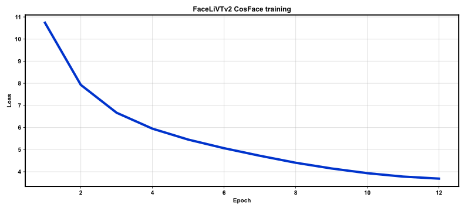
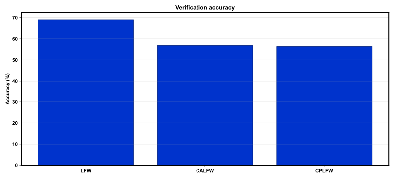

# REPORT: FaceLiVTv2 — full

**Protocol:** `full`  
**Variant:** `xs`  
**Params:** 6641024  

## Summary

| Benchmark | Accuracy | EER | Pairs |
|-----------|----------|-----|-------|
| LFW | 68.98% | 31.02% | 6000 |
| CALFW | 56.82% | 43.18% | 6000 |
| CPLFW | 56.33% | 43.67% | 6000 |

## Training

- Epochs: 12
- Train images: 141610
- Identities: 7124
- Elapsed: 2569.78 s
- Checkpoint: `outputs/checkpoints/full/last.pt`

## Figures

### `train_loss.svg`



### `bench_acc.svg`



## Reproduce

```bash
bash scripts/smoke.sh
bash scripts/train_full.sh
```

## Notes

- Backbone from upstream FaceLiVT (`facelivtv2_*`); CosFace head; CelebA train (see DEVIATIONS.md).
